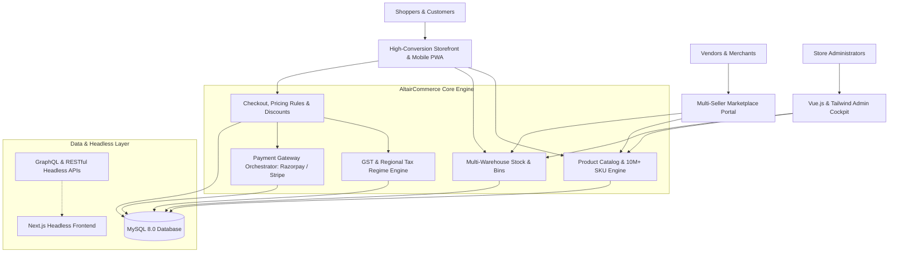

<p align="center">
  
</p>

<h1 align="center">AltairCommerce</h1>
<h3 align="center">Enterprise Headless Commerce & Multi-Vendor Marketplace Engine</h3>

<p align="center">
  <strong>The Eagle Star of High-Throughput Retail, 10M+ SKU Inventory & Multi-Seller Marketplaces</strong><br />
  Production-Grade, Zero-GMV-Tax Alternative to Shopify Plus & Adobe Commerce for Agencies & Global Brands
</p>

<p align="center">
  <a href="https://github.com/wtfear"></a>
  <a href="https://github.com/wtfear/AltairCommerce/actions"></a>
  <a href="./LICENSE"></a>
  <a href="https://laravel.com"></a>
  <a href="https://vuejs.org"></a>
  <a href="https://tailwindcss.com"></a>
  <a href="https://www.mysql.com"></a>
</p>

---

## 🌟 Executive Overview

**AltairCommerce** (named after Alpha Aquilae, the luminous flying eagle star of the Summer Triangle) is an MIT-licensed, enterprise-scale **e-commerce and multi-vendor marketplace engine** built on **Laravel, Vue.js, Tailwind CSS, and MySQL**.

While proprietary platforms like Shopify Plus demand hefty subscription fees ($2,000+/mo) plus a 0.5%–2% cut of gross merchandise value (GMV), AltairCommerce gives enterprise merchants and digital agencies **100% margin retention with zero transaction taxation**. It ships out-of-the-box with a high-conversion storefront, advanced Vue.js admin cockpit, multi-vendor marketplace capabilities, multi-warehouse inventory control (tested up to 10M+ SKUs), comprehensive GST/tax calculation, and native payment gateways (Razorpay, Stripe, PayPal, Cash on Delivery).

---

## 🏛️ Architecture & Operational Capabilities



### 1. 🛍️ Turnkey Storefront & Multi-Vendor Marketplace
- **Out-of-the-Box Storefront:** Immediate high-conversion checkout, product reviews, wishlists, faceted search, and mega-menus.
- **Multi-Vendor Architecture:** Onboard independent sellers with dedicated vendor dashboards, commission calculations, and automated payout splitting.

### 2. 📦 10M+ SKU Inventory & Multi-Warehouse Control
- Track physical inventory across unlimited regional fulfillment centers and retail store locations.
- Automated low-stock thresholds, backorder allocations, and warehouse routing logic.

### 3. 💳 Global & Indian Regional Payment Gateways
- Native integrations for **Razorpay, Stripe, PayPal, PayU, and Cash on Delivery**.
- Multi-currency conversion with real-time exchange rates and localized payment flows.

### 4. ⚖️ Comprehensive GST & Tax Compliance
- Multi-tier tax rates, HSN code classifications, and compound regional tax rules.
- Automated invoice PDF generation with full tax compliance breakdown.

### 5. ⚡ Headless Commerce Ready
- Decouple your frontend using official GraphQL and RESTful APIs.
- Compatible with Next.js, Nuxt, mobile apps (Flutter, React Native), and POS hardware.

---

## 🚀 Quick Start (Local Docker)

Launch AltairCommerce with containerized MySQL:

```bash
# 1. Clone repository
git clone https://github.com/wtfear/AltairCommerce.git
cd AltairCommerce

# 2. Launch container stack
docker compose up -d

# 3. Access storefront & admin
open http://localhost:8000
open http://localhost:8000/admin
```

---

## ☁️ Cloud Deployment Options

| Platform | Deployment Mode | Tier | Manifest |
|---|---|---|:---:|
| **Render** | Docker Web Service + Managed MySQL | Standard | [`render.yaml`](./render.yaml) |
| **AWS / GCP VPS** | Docker Compose (Nginx + PHP 8.4 + MySQL) | \$15–\$50/mo | [`docker-compose.yml`](./docker-compose.yml) |
| **Railway** | Docker Container Auto-Deploy | Hobby / Pro | [`Dockerfile`](./Dockerfile) |

---

## 🌌 The WTFear Celestial Enterprise Portfolio

AltairCommerce anchors the high-throughput transactional tier of the **WTFear Celestial AI Suite**:

| Star | Flagship Platform | Category | Stack |
|---|---|---|---|
| 🌟 **Altair** | **`AltairCommerce`** | Enterprise Headless Commerce & Multi-Vendor Engine | Laravel 11/12, Vue.js, MySQL |
| 🌟 **Polaris** | **`PolarisERP`** | Autonomous Enterprise ERP, CRM & WMS | Next.js 15, PostgreSQL, TurboRepo |
| 🌟 **Aldebaran** | **`AldebaranCRM`** | Enterprise Sales Pipeline & Quotation CRM | Laravel, Vue.js, MySQL |
| 🌟 **Vega** | **`VegaDocs`** | Air-Gapped Document Intelligence & RAG | React, Node.js, Vector DBs |
| 🌟 **Sirius** | **`SiriusIQ`** | Enterprise Workplace Knowledge OS & RAG | Next.js, FastAPI, Vespa, PostgreSQL |
| 🌟 **Capella** | **`CapellaBI`** | BI-as-Code & Unit Economics Cockpit | DuckDB-WASM, Svelte, SQL |
| 🌟 **Arcturus** | **`ArcturusFlow`** | Visual Agentic Workflow & Multi-Agent Builder | Python, React, FastAPI, MCP |

---

## 📄 License & Attribution

- **Core License:** [MIT License](./LICENSE) — 100% Free for commercial, agency, and enterprise client white-label deployments.
- **Upstream Engine:** Built on the battle-tested [Bagisto](https://bagisto.com) enterprise e-commerce core.
- **Maintained & Enhanced by:** [WTFear Agency](https://github.com/wtfear) & **Pavan Kumar Kunukuntla**.
